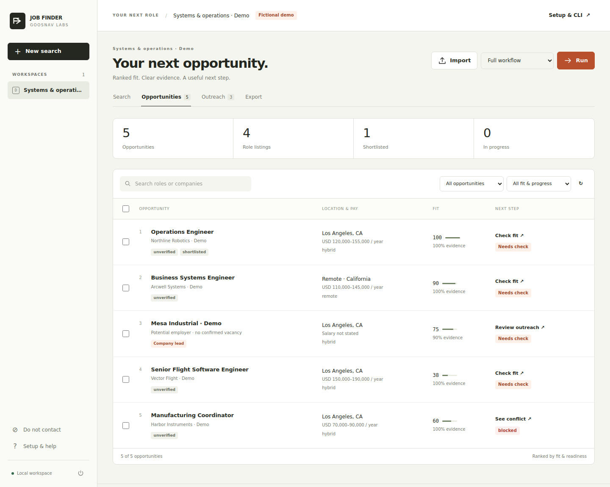

# Job Finder

**Turn a career objective into a ranked list of jobs, researched employers, and short outreach you can review.**

A local app from Goosnav Labs, built around your installed **Codex** or **Claude Code** CLI. Describe the work you want, optionally add a résumé, and run a bounded workflow. Open a direct application link or export reviewed outreach to your email tool. Choose the provider and model separately for profiling, discovery, research, and writing.



*Fictional demo data. [Fit and evidence](docs/screenshots/opportunity-review.png) · [Outreach review](docs/screenshots/outreach.png) · [Mobile](docs/screenshots/mobile.png).*

## Start

Install [uv](https://docs.astral.sh/uv/getting-started/installation/), then:

```sh
git clone https://github.com/goosnav/job-finder.git
cd job-finder
uv run --project app --no-dev python app/run.py gui
```

The app opens on a free local port. Select **Try the demo** to exercise the complete workflow without an agent account. Its five opportunities and all people are fictional; actionable application and outreach exports exclude demo data.

For live work, install and sign in to [Codex](https://developers.openai.com/codex/cli/) or [Claude Code](https://code.claude.com/docs/en/overview). Job Finder uses that CLI's authentication and checks its required capabilities. It does not store API keys. Your chosen provider receives the candidate material needed for its task; local storage does not mean offline AI processing.

```sh
uv run --project app --no-dev python app/run.py doctor --json
```

An unsupported CLI version produces a setup instruction. A desktop launcher can use `JOB_FINDER_CODEX_BIN` or `JOB_FINDER_CLAUDE_BIN` to locate a native executable outside PATH. On Windows, point to the underlying `.exe`, not a `.cmd`/`.bat` wrapper. Provider subscriptions, usage limits, and charges are separate.

### Native app

The repository includes a reproducible builder for one ZIP containing macOS universal, Windows x64/ARM64, and Linux x86_64/ARM64 launchers. A built ZIP provisions pinned Python and dependencies automatically. It still requires Codex or Claude for live research.

All five launcher images have been built. Linux x86_64 passed a headless-browser smoke test through setup, the real GUI, a completed demo, second-launch reuse, restart persistence, and Quit. **Native desktop acceptance on macOS, Windows, and ARM remains unverified.** Images are unsigned development builds. [Installation, data locations, and building the ZIP](docs/INSTALL.md).

GitHub **Actions → Build native ZIP → Run workflow** creates a downloadable workflow artifact. It does not publish a release.

## What it does

1. **Profile.** Read the objective, original résumé, and supporting documents. Build a cached brief with suitable and adjacent role titles, demonstrated strengths, gaps, and questions. An objective alone works, but experience remains unknown until supplied.
2. **Discover.** Search employer career pages, public ATS postings, specialist boards, associations, startup/investor portfolios, and hiring-related news. Direct adapters can also ingest known Greenhouse, Lever, and Ashby boards. Different roles at the same employer remain separate records.
3. **Research.** Give each opportunity its own bounded agent call. Check the actual role, requirements, disclosed compensation, location restrictions, company activity, and public professional contacts. Retain source excerpts and dates. Compare the role with original candidate evidence.
4. **Verify.** Independently inspect accessible sources, role-specific application evidence, deadlines, and email routing. A reachable page alone does not prove an opening. Missing or blocked information stays unresolved.
5. **Draft.** Give each suitable opportunity a separate writing call using its saved dossier. Produce one initial inquiry and two distinct follow-ups without repeating the web research for each message.
6. **Review and act.** Inspect the fit breakdown and unresolved conditions, edit the three emails, approve outreach, open application links, and track progress. Export the full research, an application list, an outreach list, or a shortlist.

The app prepares work. It does not submit applications, send messages, sign into job sites, or change your résumé automatically.

### Open roles and company leads

An **open role** has a specific job posting and, where confirmed, a direct application link. A **company lead** is an employer worth approaching without a confirmed vacancy. A funding round, new contract, expansion, or new team can make a company worth researching; it cannot establish an available role or budget for your hire.

Each signal retains its source, publication date, and event date when known. Company-lead copy asks about possible needs rather than claiming a vacancy. General applications and talent communities also remain company leads.

Public ATS behavior and current limitations are documented in [Sources](docs/SOURCES.md), with links to the vendors' primary documentation.

## Ranking you can inspect

The agent extracts assessments and evidence. Code calculates the score with visible weights:

| Factor | Default weight | Meaning |
|---|---:|---|
| Role | 20 | Alignment with the work you want |
| Skills | 25 | Evidence of relevant skills and work |
| Seniority | 10 | Scope and experience alignment |
| Location | 15 | Location and work arrangement |
| Compensation | 10 | Disclosed pay against your minimum |
| Preferences | 15 | Industry, employment type, and stated conditions |
| Timing | 5 | Recency and credible hiring signals |

A strong supported match earns the factor's points; a partial match earns half. A gap or unknown earns none. Unspecified compensation/location factors are excluded and remaining weights are normalized. Timing never exceeds 5% of the score, even with custom weights. Positive skill and seniority assessments require a supporting quote from original candidate material. Generated summaries cannot manufacture résumé evidence.

**Fit, evidence coverage, and eligibility are separate.** Evidence coverage is the weighted share of assessed factors, not an independent accuracy rating or probability of an offer. Explicit conflicts are shown separately from unknowns. The app checks salary units/currency without invented conversions, remote geography, strict work-mode preferences, sponsorship, clearance, authorization, and must-haves. It does not infer protected characteristics or assume that remote means worldwide.

Blocked and skipped opportunities remain visible below usable results. An older posting calls for a freshness check; a published expired deadline or closed posting is a blocker. Original posting dates, source updates/republishing, and actual check times remain separate.

## Your inputs and the output

Provide the objective first. Optional fields include target and adjacent roles, locations, work modes, industries, seniority, minimum annual pay and currency, employment types, relocation, must-haves, and exclusions. Enter authorization, sponsorship needs, or clearance only when you want those facts used.

Paste résumé text or upload up to four TXT, Markdown, PDF, DOCX, or CSV documents: 8 MB each and 60,000 extracted characters total across pasted text and documents. Scanned PDFs need OCR before upload. The profile stage reads all accepted material; each opportunity receives bounded relevant original excerpts plus the cached brief. Missing résumé evidence remains a question, never a fabricated qualification.

Each CSV row represents a specific opportunity. XLSX adds a separate source-excerpt sheet.

| Group | Exported information |
|---|---|
| Priority | Rank, fit score, evidence coverage, eligibility, next action, blockers |
| Opportunity | Employer, role, kind, requisition, official company/listing/application/careers URLs |
| Conditions | Location, remote eligibility, work mode, employment type, seniority, salary range/currency/period |
| Requirements | Authorization, sponsorship, clearance, qualifications, gaps, unanswered questions |
| Research | Evidence URLs/excerpts, research summary, company signals, posting/update/check dates |
| Application help | Relevant résumé claims with exact supporting quotes, interview hooks, application tips |
| Outreach | Public contact and source, email status, all three subjects/bodies, delay days, supporting sources |
| Tracking | Shortlisted/applied/contacted/replied/interview/offer and other outcomes, notes, follow-up date |

Emails use 1–5-word subjects, up to 90 words initially and 65 in each follow-up, short sentences, one request, and distinct reasons for contact. Copy checks flag placeholders, unsupported cited sources/declared candidate claims, repeated bodies, hype, and fake reply prefixes. Human review is still needed to catch a subtly exaggerated claim or weak personalization. Writing is inspired by Simplified Technical English; it does not claim full ASD-STE100 compliance.

### Export scopes

- **All research:** every row and its unresolved checks; useful for your own review.
- **Apply:** specific open roles with a recently checked direct employer/ATS application link, sufficient fit, no hard conflict, and no previous application or exclusion.
- **Outreach:** approved, current research with a sourced public professional email, usable copy, sufficient fit, candidate name/reply address, and no prior contact or exclusion. One message sequence per mailbox, choosing the highest-ranked eligible opportunity.
- **Shortlist:** rows you explicitly shortlisted.

Published and MX-found addresses are not labelled mailbox-verified. You can import an external verifier's result and actual check date; verified status expires for outreach after 30 days. Invalid/bounced email suppression does not remove an otherwise valid website application. Skipping one job does not exclude the whole employer. Explicit domain exclusions affect the whole company.

The exported email bodies **already include your signature**. Suggested follow-ups are days 5 and 12 from first contact. Your email tool must stop the sequence on any reply, bounce, or opt-out. Tracking here is manual or imported, not an automatic connection to an inbox or ATS. See the [CSV templates](examples/).

## Models, budgets, and progress

Select a default CLI and model, then override either for **Profile**, **Discovery**, **Research**, and **Outreach**. A blank model uses the relevant CLI's default. Switching a task to a different provider with a blank model uses that provider's default, not the other provider's model name.

The workflow makes multiple bounded calls: one cached profile; a small number of discovery batches; one research call per opportunity; one writing call per qualified opportunity for its three-message sequence. Verification uses bounded HTTP/DNS checks. Research, draft, and discovery caches are independent. Changing only the outreach model preserves completed research.

Controls include target count, query count, minimum fit, total calls, running time, per-call timeout, research-page allowance, concurrency (1–4), and Claude turn/cost limits. The target is a discovery limit, not a promise of that many qualified jobs. Search stops when the target or bounds are reached, or successive batches find no new records.

Claude's reported spend and conservative allowances are shown separately; they are not a guaranteed billing ceiling. Calls with unreported cost retain an allowance. Codex has no equivalent enforced dollar cap in this integration, so calls, time, and output size bound its work. Each call records task/provider/model and reported usage when available. Unknown usage stays unavailable rather than being displayed as zero.

Progress shows actual stage counts, current work, elapsed time, usage, and events. Pause, resume, cancellation, checkpoints, and crash recovery preserve successful work. Updating relevant candidate/preferences/source-research inputs invalidates affected research and approval. Increase an exhausted budget and resume when appropriate.

## CLI

The GUI and CLI use the same application service. Use `uv run --project app --no-dev python app/run.py` as the prefix for these commands. Operational commands support `--json`.

```sh
# Create a search without spending agent calls.
uv run --project app --no-dev python app/run.py search create \
  --name "Operations engineering" \
  --objective "Build practical automation tools for engineering and manufacturing teams" \
  --resume /path/to/resume.pdf \
  --role "Operations Engineer" --role "Business Systems Engineer" \
  --location "Los Angeles, CA" --work-mode hybrid --work-mode remote \
  --salary-min 100000 --provider codex --target 25 --max-calls 80 --json

# Use the returned search ID.
uv run --project app --no-dev python app/run.py run SEARCH_ID --stage pipeline
uv run --project app --no-dev python app/run.py opportunities SEARCH_ID --min-fit 70
uv run --project app --no-dev python app/run.py export SEARCH_ID \
  --format xlsx --scope all --output exports/job-research.xlsx

# Change only the writing provider; its default model is used.
uv run --project app --no-dev python app/run.py run SEARCH_ID \
  --stage draft --outreach-provider claude
```

Use `--profile-model`, `--discovery-model`, `--research-model`, and `--outreach-model` with model IDs supported by your selected CLI/account. Equivalent provider flags accept `codex`, `claude`, or `inherit` at the task level. Advanced settings, including weights and all constraints, can come from [search-settings.json](examples/search-settings.json):

```sh
uv run --project app --no-dev python app/run.py search create --config examples/search-settings.json --json
uv run --project app --no-dev python app/run.py schema search --json
```

| Command | Purpose |
|---|---|
| `search list / show / configure` | Inspect searches or apply a JSON patch |
| `resume-upload ID --file FILE` | Add résumé/supporting documents |
| `import-opportunities ID FILE` | Import CSV/XLSX; imported live-status claims need verification |
| `run ID --stage profile/discover/research/verify/draft/pipeline` | Execute an individual stage or full workflow |
| `runs list / show` | Progress, events, usage, failures |
| `pause RUN_ID`, `resume RUN_ID`, `cancel RUN_ID` | Control durable work; Ctrl-C pauses |
| `opportunities ID --json` | Ranked records with checks and export blockers |
| `edit-opportunity ID --file patch.json` | Edit contact, drafts, notes, or tracking |
| `review OPPORTUNITY_ID --status approved` | Record human outreach review |
| `activity OPPORTUNITY_ID --status applied` | Record an application/contact outcome |
| `verify-import ID FILE --source Verifier` | Import actual mailbox checks |
| `outcomes-import ID FILE` | Import progress using opportunity ID or job URL |
| `suppress add --email ...` or `--domain ...` | Exclude a mailbox or employer |
| `export ID --scope all/apply/outreach/shortlist --output FILE` | CSV/XLSX handoff |
| `backup --output FILE` | Consistent SQLite backup |
| `demo --run --json` | Complete offline fictional example |

Application outcomes need a job ID or URL when several jobs share an email address. A mailbox match cannot mark several unrelated jobs as applied. Cross-search history guards against repeated outreach.

Exit codes: `0` complete; `2` invalid input/setup; `3` failed run; `4` exhausted budget; `5` paused/cancelled. JSON errors contain `error.code` and `error.message`. CLI workers run in the foreground; use your own process supervisor for unattended execution.

## Privacy, architecture, and validation

SQLite data lives in your OS's `JobFinder` application-data directory, separate from Auto Outbound. `--data-dir` or `JOB_FINDER_DATA` chooses another workspace. The app has no telemetry or hosted account. Uploaded text, research, and exports can contain personal information; keep backups private. [Security and data behavior](docs/SECURITY.md).

Python/FastAPI, SQLite, and static HTML/CSS/JavaScript form the app. No frontend build or runtime CDN is needed. Provider processes run with restricted tools in isolated temporary directories. Local mutations require a per-launch token and same-origin checks. Fetching rejects nonpublic addresses and unsafe redirects; document sizes and spreadsheet cells are bounded. [Architecture](docs/ARCHITECTURE.md) · [HTTP API](docs/API.md).

```sh
uv sync --project app --locked
uv run --project app ruff check --config app/pyproject.toml app/src tests
uv run --project app python -m pytest -c app/pyproject.toml tests
```

Tests cover real SQLite/API/CLI flows, ranking, model routes, resumability, call/cost budgets, subprocess contracts, direct-source parsers, source-fetch restrictions, document imports, and exports. Browser smoke checks use the actual GUI with fictional data. Live authenticated model relevance and drafting quality have not been benchmarked with a real résumé in this build. Run a small live search and review its evidence before scaling.

## Useful next additions

The first iteration already includes the practical essentials: freshness checks, explicit eligibility, deduplication, evidence, application links, reviewed outreach, and a feedback trail. The next improvements should follow actual search results:

- **Recurring discovery and change alerts:** identify newly posted roles and closing dates without reprocessing unchanged records.
- **Warm introductions:** let the user import contacts/referral paths and prioritize authentic connections without pretending a relationship exists.
- **Reviewed résumé variants:** propose role-specific edits with a visible diff and exact original evidence for every claim.
- **Outcome-based calibration:** use your own replies, interviews, and rejected-fit reasons to adjust weights and search vocabulary.
- **Email/ATS integrations:** reconcile external activity to stop unnecessary follow-ups and reduce manual tracking.

No amount of additional discovery replaces reviewing the actual role, submitting a relevant application, and following through on conversations. This app makes that work easier to prioritize and prepare.
