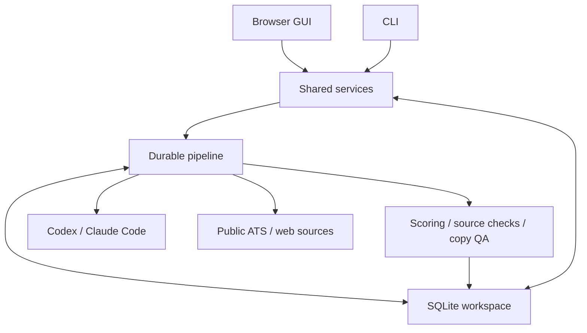

# Architecture

Job Finder is a local Python application with one shared service layer, a browser interface, and a CLI. Installed Codex or Claude Code CLIs perform bounded research tasks. SQLite holds the search, evidence, drafts, run state, and application history. The app prepares work for the user to review; it has no email transport or application-submission service.

## Components

| Component | Responsibility |
|---|---|
| `models.py` | Validated candidate, preferences, opportunity, evidence, research, sequence, and route contracts. |
| `service.py` | Search edits, résumé extraction, opportunity identity, review, suppression, application tracking, imports, and export guards. |
| `pipeline.py` | Durable stages, checkpoints, provider routing, bounded concurrency, budgets, cancellation, and worker ownership. |
| `providers.py` | Explicit Codex/Claude process arguments, capability checks, structured output, deadlines, usage parsing, and process cleanup. |
| `sources.py` / `research.py` | Public ATS adapters, page/JSON-LD inspection, bounded public-network access, evidence checks, and email DNS checks. |
| `ranking.py` / `quality.py` | Explainable fit, evidence confidence, eligibility, next actions, and outreach quality checks. |
| `storage.py` / `files.py` | SQLite transactions, original extracted candidate text, safe imports, and job-specific CSV/XLSX. |
| `api.py` / `static/` / `cli.py` | HTTP/browser and terminal interfaces to the same services. |
| `launcher/` / `scripts/launcher/` | Managed setup, loopback readiness, stable native images, and universal ZIP assembly. |

## Search and opportunity model

A search contains an objective, optional candidate résumé and explicit facts, job preferences, score weights, and execution settings. Candidate documents remain original evidence. A generated career brief is useful context, but cannot establish a new credential or achievement.

An opportunity is either a specific `open_role` or a `company_lead` without an established vacancy. Funding, expansion, contract awards, products, team growth, and similar news are dated research signals. They do not become a job listing by inference. Research preserves the original kind and opening identity; a newly discovered vacancy belongs in its own row.

Openings deduplicate by known ATS identity or canonical listing/application URL. Multiple openings at one employer remain separate. Company leads use the employer domain or a known ATS board. Review state, application state, contact status, and listing status are separate fields because a closed mailbox and a closed vacancy have different consequences.

## Five bounded stages

| Stage | Agent route | Work and persisted output |
|---|---|---|
| Profile | `profile` | One offline call reads the complete accepted résumé material and objective. Saves suggested role titles, strengths, gaps, and unknowns. |
| Discover | `discovery` | Reads optional public ATS boards, then runs separate bounded web-search batches. Saves sourced, deduplicated seeds. |
| Research | `research` | One call per opportunity gathers evidence and match components within the configured page/search budget. Code calculates scores. |
| Verify | No agent | Checks the intended posting, structured metadata, quoted evidence, published email source, and mail-domain DNS. |
| Draft | `outreach` | One offline call per suitable opportunity produces three short messages using its saved dossier and supported candidate claims. |

A full pipeline uses all five stages. A standalone stage does not secretly trigger a profile call. Profile output is cached by its full input fingerprint. Research and drafts have separate fingerprints, so changed candidate material or research settings invalidate relevant work while unchanged successful work can be reused.

Discovery considers a bounded pool of up to 1,000 postings from each configured board; individual adapters have stricter response, pagination, and time limits. It ranks title/skill overlap before retaining results. When target terms exist, zero-overlap board rows do not consume the target ahead of web discovery. Agent batches stop when the target is met, the query allowance ends, or two batches add no new results.

## Evidence, ranking, and freshness

Fit uses weighted role, skills, seniority, location, compensation, preferences, and timing components. Unknown or unsupported assessments do not earn matching points. Résumé-dependent components require a quote found in original candidate material. Timing is capped at a small contribution so funding news cannot outweigh qualifications. Evidence confidence measures the supported assessment; neither number is a probability of being hired.

Hard conflicts produce blockers. Missing sponsorship, remote geography, compensation units, clearance, or other material facts produce questions. Salary comparisons require compatible units and currency; the app does not invent exchange-rate or hourly-to-annual conversions. Older postings prompt review. Actual closure or an expired stated deadline blocks the opening; a date-only deadline includes its stated day.

Verification reads the intended listing through the structured inspector within the same page budget. It only applies `JobPosting` metadata that matches the actual opening by an explicit URL or by title plus employer/requisition. It does not import unrelated expired records from a mixed careers page. HTTP 404/410 at the intended listing closes that row; access denial or a timeout leaves uncertainty. A reachable page alone does not establish an active opening.

A fresh direct ATS result retains its adapter provenance. Model output cannot claim that it came from a trusted adapter. Web discoveries and imported rows cannot promote themselves to authoritative ATS records. Published email text is checked separately from DNS: an address missing from an unavailable or unreadable source stays unknown unless an independent verification record is still valid.

## Routing and budgets

Each of `profile`, `discovery`, `research`, and `outreach` can inherit the global provider/model or select a different provider/model. Demo mode overrides live routes. Provider setup is checked only for the selected stage's required routes; Verify requires no model.

All providers share hard call and elapsed-time limits. Requests also have timeouts, bounded output, and limited concurrency. Every attempt, including a retry, counts as a call. Claude calls share a separate dollar allowance: concurrent calls reserve capacity, reported cost settles it, and unreported work retains its reservation conservatively. Codex is bounded by calls/time; its usage is not represented as an enforceable Claude dollar limit. Run usage records preserve task, provider, model, token counts, and reported cost when available.

## Durability and lifecycle

Completed research is saved before the next cancellation checkpoint. Pausing after a provider returns does not discard that paid result. Resume retries incomplete work. A transactional worker token prevents two managers from claiming the same queued run. A unique SQLite index permits only one active run per search, with a second global guard limiting simultaneous searches.

Interrupted workers recover to paused state when their process is gone. Unreported Claude reservations remain consumed until the user reviews or increases the allowance. Quit requests a pause and supervises child shutdown. Closing a browser tab leaves the local server running.

## Native distribution

The universal ZIP contains five launcher images, `README.txt`, `LICENSE.txt`, and `app/`. Mutable source, static assets, the lockfile, and launcher manifest remain under `app/`; source-only updates reuse stable launcher images. The Go supervisor opens a local setup page, bootstraps pinned Python/dependencies through bundled `uv`, waits for readiness, and redirects to the workspace. Runtime, database, logs, and caches live in the separate OS-specific `JobFinder` data directory.

See [Install and launch](INSTALL.md) for build commands and platform limitations. The images are unsigned development builds. Linux AppImage setup, headless-browser workflow, instance reuse, Quit, and restart have been exercised; the complete native desktop and failure-recovery matrix is still unverified.

## Report and script preview revision

The GUI defaults to the shared `report` workflow: profile, discover, research, and verify. The existing `pipeline` workflow still includes draft. Report runs do not require the outreach provider. CSV preserves the detailed schema; Excel adds a first Report sheet for search parameters, ranked jobs, and application links. No database migration is required.

The explicitly requested script preview uses `.command`, `.cmd`, `.ps1`, and `.sh` wrappers around the same Go supervisor. It bundles six compiled supervisors under `app/launcher/bin/` and uses the same runtime fingerprint, instance lock, readiness checks, browser status page, and external data directories as the native edition. The script ZIP has its own explicit packaging whitelist. It is a preview under M1a; it does not replace the native universal ZIP acceptance matrix.

The compact GUI opens directly to the jobs table. Search selection uses a header dropdown. Jobs, Shortlist, Search settings, and Outreach are direct views. Report generation and CSV/Excel export stay above the table. The GUI has no sidebar, summary metrics, report prose, hero, or workflow-stage dropdown. A row star toggles new/shortlisted jobs only; other application states retain their progress. Completed runs clear the progress panel.
